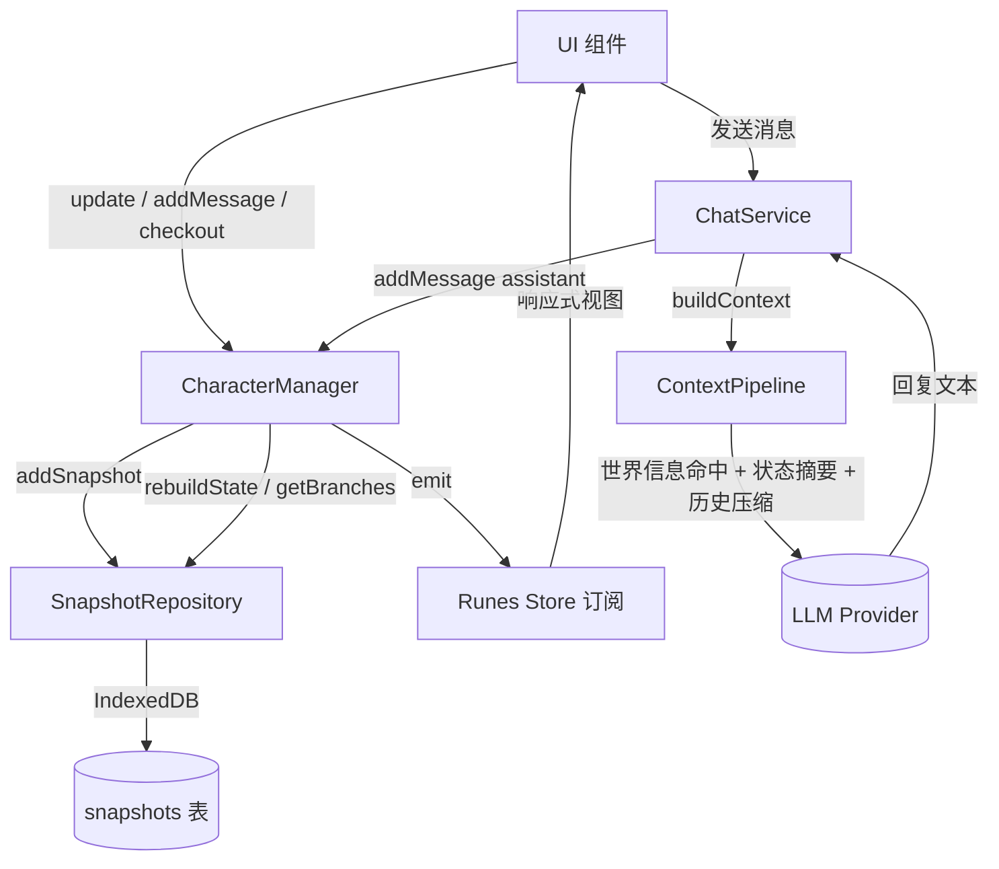
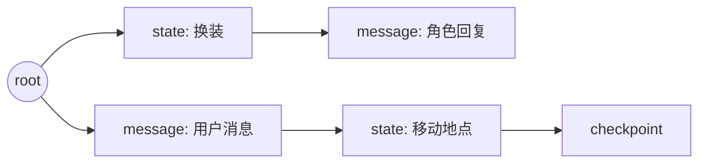
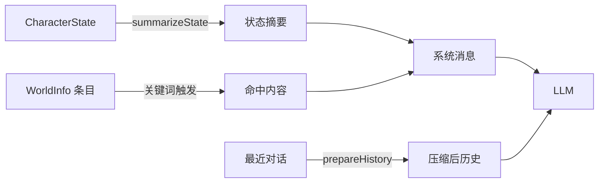

# CosBox 架构

## 设计原则

1. **状态驱动叙事**：`CharacterState`（outfit / location / places / schedule / attributes）是应用的第一公民数据。
2. **单一变更入口**：一切状态修改必须经过 `CharacterManager.update()`，先校验、再落快照、后生效。
3. **串行化变更**：所有变更（update / addMessage / checkout / advanceTime / addCheckpoint）经内部队列串行落地，
   避免并发写导致的分支错乱与状态覆盖。
4. **无副作用 checkout**：切换分支只做纯重建（读 IndexedDB + 应用 delta），绝不写快照表。
5. **浏览器内自带版本控制**：以「增量快照链」实现类 Git 语义，不依赖外部 Git 运行时。

## 数据流

## 快照版本图

- 节点结构：`{ id, timestamp, parentId, metadata: { type, desc }, delta }`。
- `delta` 三态：`{ kind: 'state', patch: StatePatch }`、`{ kind: 'message', ... }`、`null`（检查点）。
- **分支**：任何没有子节点的节点都是一个分支 tip；从该 tip 继续追加即开新分支。
- **重建**：沿 `parentId` 回溯到根，按时间顺序应用状态补丁、收集消息；根自身不参与 delta 应用（初始状态即根基线）。
- **checkout**：`rebuildState(targetId)` 的纯读别名，不产生任何写入。

存储：IndexedDB `snapshots` 表，索引 `id, [parentId+timestamp], parentId, timestamp`。

## 状态模型

- `outfit`：当前穿着（headwear / top / underwear / underpants / bottom / socks / shoes / accessories）
  - `wardrobe` 衣柜（衣物预设，带分类与穿后描述）。
- `location`：当前所在地（带分类）；`places`：地点库（AI 认知中的全部地点，带分类，如「学校 > 食堂」，
  与日程相互独立）。
- `schedule`：时间与周期性日程；`attributes`：自由键值属性。
- LLM 上下文中的状态摘要包含【已知地点】与【衣柜】清单（含分类前缀），AI 换装/移动时从清单中选择，而非自行脑补。

## 模块边界

| 模块             | 职责                                             | 依赖方向        |
| ---------------- | ------------------------------------------------ | --------------- |
| `core/`          | 类型、状态校验/合并、版本图纯函数、错误体系      | 无（纯函数）    |
| `db/`            | Dexie schema、快照/世界书/kv 仓储                | core            |
| `manager/`       | 状态变更编排（校验→快照→应用→刷新）              | core, db        |
| `context/`       | World Info 触发、状态摘要、历史压缩、Prompt 组装 | core, llm/types |
| `llm/`           | OpenAI-compatible 客户端、离线 demo、ChatService | core, context   |
| `import-export/` | chara_card_v3 解析与序列化                       | core            |
| `stores/`        | Svelte 5 runes 响应式封装（薄层，不含业务逻辑）  | manager, db     |
| `components/`    | 展示与表单（显式 props，无 rest 透传）           | stores, core    |

## Context Pipeline

输出 `ContextBundle`：`systemMessage`（基础提示 + 状态摘要 + 世界设定）与可直接提交给
Chat Completions API 的 `messages` 数组。

## 错误处理约定

- 所有异步操作带 `try/catch`，统一翻译为 `CosBoxError` 子类。
- UI 通过 `toUserMessage()` 展示可读文案，不泄露堆栈。
- 测试覆盖每个仓储的失败路径（关闭数据库触发）。

## 测试策略

- 核心层（`core/context/db/manager/llm/import-export/utils`）：Vitest，语句/行/函数覆盖 100%，分支 94%。
- UI 流程：Playwright e2e（对话、状态编辑、版本切换、时间推进、V3 导入）。
