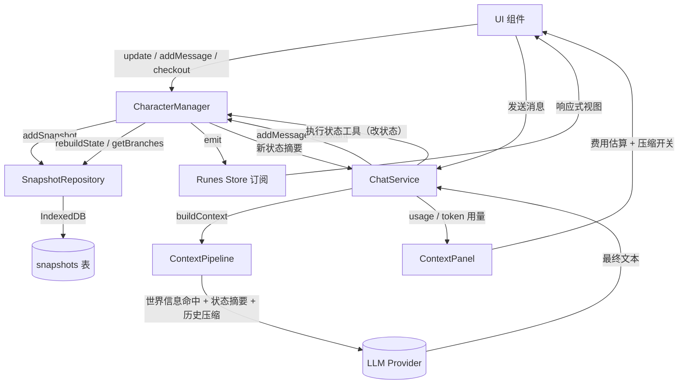
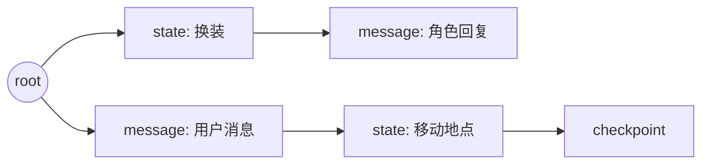
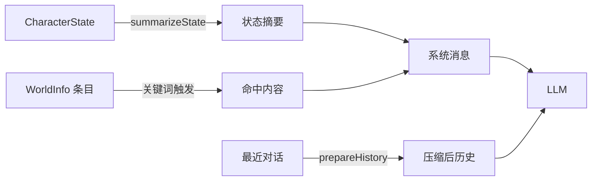
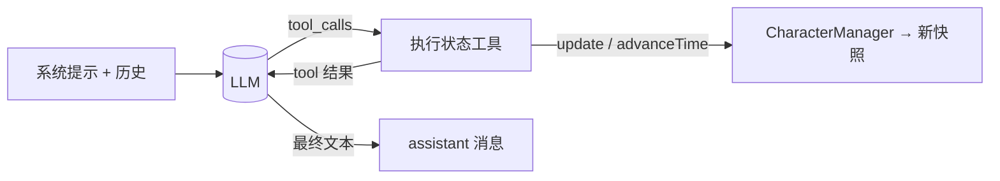

# CosBox 架构

## 设计原则

1. **状态驱动叙事**：`CharacterState`（outfit / location / places / schedule / attributes）是应用的第一公民数据。
2. **单一变更入口**：一切状态修改必须经过 `CharacterManager.update()`，先校验、再落快照、后生效。
3. **串行化变更**：所有变更（update / addMessage / checkout / advanceTime / addCheckpoint）经内部队列串行落地，
   避免并发写导致的分支错乱与状态覆盖。
4. **无副作用 checkout**：切换分支只做纯重建（读 IndexedDB + 应用 delta），绝不写快照表。
5. **浏览器内自带版本控制**：以「增量快照链」实现类 Git 语义，不依赖外部 Git 运行时。
6. **世界配置与剧情状态分离**：地点库 / 衣柜 / 日程条目是「世界配置」，维护性编辑
   单独持久化（kv），不生成快照、不进版本历史；剧情状态（当前地点、当前穿着、时间、
   属性、对话）仍走快照链。

## 数据流

## 快照版本图

- 节点结构：`{ id, timestamp, parentId, metadata: { type, desc }, delta }`。
- `delta` 三态：`{ kind: 'state', patch: StatePatch }`、`{ kind: 'message', ... }`、`null`（检查点）。
- **分支**：任何没有子节点的节点都是一个分支 tip；从该 tip 继续追加即开新分支。
- **重建**：沿 `parentId` 回溯到根，按时间顺序应用状态补丁、收集消息；根自身不参与 delta 应用（初始状态即根基线）。
- **checkout**：`rebuildState(targetId)` 的纯读别名，不产生任何写入。
- **展示顺序**：分支列表按最后时间倒序（新的在上）；分支内快照链按「新的在上、旧的在下」排列。

存储：IndexedDB `snapshots` 表，索引 `id, [parentId+timestamp], parentId, timestamp`。

### 分支删除

- 只能删除「分支末端链」：从某个 tip 沿 parentId 回溯到分支点（不含分支点与根）的一整段链。
- 若当前 head 位于被删链上，先 `checkout` 到链的父节点（分支点或根），保证 head 永远有效。
- 根快照与任何非末端节点不可删除（防止孤儿链）；删除在 `CharacterManager` 的串行队列内执行。

### 世界配置覆盖

- 「地点库」「衣柜管理」「日程表」面板的维护性编辑（增删改条目）调用
  `CharacterManager.applyConfig()`：只更新内存态并写入 kv（`config.overrides`），
  不生成快照、不推进 head，因此不会出现在版本/分支中。
- 每次从快照链重建状态（init / checkout / 删除分支）后，把配置覆盖叠加回状态
  （`applyConfigOverrides`，整体替换 places / outfit.wardrobe / schedule.entries）。
- 剧情状态不受影响：在面板里「设为当前地点」「更换当前穿着」「推进时间」仍走 `update()`
  生成快照。
- 排序：地点库 / 衣柜管理支持**拖拽排序**（`moveItemToTarget` 在分类内重排源数组并持久化，
  同属世界配置）；日程表按 `day → start → end → title` 自动排序（展示与存储都排序，
  `sortScheduleEntries`）。
- 导入导出：地点库 / 衣柜 / 日程各支持导出 JSON 模板与导入合并（按名称去重，
  `config-transfer`）；设置页支持导出/导入**工作区**（.cbox，ZIP 容器，零依赖
  `utils/zip`），包含对话快照、世界配置、世界书、角色档案与开发者开关，
  **不含模型配置**（API Key 不泄露）；导入前校验快照链可重建，导入后整体重载。

## 状态模型

- `outfit`：当前穿着（headwear / top / underwear / underpants / bottom / socks / shoes / accessories）
  - `wardrobe` 衣柜（衣物预设，带分类与穿后描述）。
- `location`：当前所在地（带分类）；`places`：地点库（AI 认知中的全部地点，带分类，如「学校 > 食堂」，
  与日程相互独立）。
- `schedule`：时间与周期性日程；`attributes`：自由键值属性。
- LLM 上下文中的状态摘要包含【已知地点】与【衣柜】清单（含分类前缀），AI 换装/移动时从清单中选择，而非自行脑补。
- 状态摘要的「穿着」按槽位带标签输出（`帽子：未穿；上衣：白色衬衫；内衣：…；配饰：…`），
  空槽位显式标注「未穿」，避免 AI 无视未穿状态。

## 模块边界

| 模块             | 职责                                                                                         | 依赖方向        |
| ---------------- | -------------------------------------------------------------------------------------------- | --------------- |
| `core/`          | 类型、状态校验/合并、版本图纯函数、错误体系                                                  | 无（纯函数）    |
| `db/`            | Dexie schema、快照/世界书/kv 仓储                                                            | core            |
| `manager/`       | 状态变更编排（校验→快照→应用→刷新）                                                          | core, db        |
| `context/`       | World Info 触发、状态摘要、历史压缩、Prompt 组装                                             | core, llm/types |
| `llm/`           | OpenAI-compatible 客户端、离线 demo、状态工具、agent 循环、token/费用估算、模型列表/连接测试 | core, context   |
| `import-export/` | chara_card_v3 解析与序列化                                                                   | core            |
| `stores/`        | Svelte 5 runes 响应式封装（薄层，不含业务逻辑）                                              | manager, db     |
| `utils/`         | 纯工具（格式化、分组、斜杠命令解析/执行）                                                    | core            |
| `components/`    | 展示与表单（显式 props，无 rest 透传）                                                       | stores, core    |

## Context Pipeline

输出 `ContextBundle`：`systemMessage`（基础提示 + 状态摘要 + 世界设定）与可直接提交给
Chat Completions API 的 `messages` 数组。

### 工具使用引导

- 开启「允许 AI 自主修改状态」后，系统提示末尾追加【工具使用】说明：告知模型它**可以
  直接调用** `goto_location / advance_time / set_outfit / set_attribute` 更新剧情状态，
  而不是只口头描述——避免模型在思考里「想调用」却不发出 tool_call。
- 语气为强指令：时间流逝/换装/转场/属性变化时**必须立即调用**对应工具，
  「我这就去」「过了几分钟」这类表述不算数。
- 引导文本由 `buildToolGuidance()` 生成，随 `ContextPipelineInput.enableStateTools` 注入。

### 消息时间标注

- 每条消息落快照时记录当时的**世界时间**（`ChatMessageView.worldTime`，随消息快照持久化）；
  组装发送上下文时内容前缀标注 `（周一 09:00）`，让模型感知剧情中每条消息发生的时刻，
  更合理地分配时间（排队、等待、转场后主动推进时间）。

### AI 生成（地点库 / 衣柜 / 日程表）

- 三个配置面板各有一个「AI地点 / AI衣物 / AI条目」按钮，打开生成弹窗：
  - 世界观预设（现代 / 古代 / 奇幻），内置规则与禁词（古代禁止机场、汽车等现代元素）；
  - 衣柜额外提供性别选项（默认 女/男，可自定义），写入生成提示词；
  - 用户输入要求后调用当前模型服务生成完整列表。
- 地点生成强调**大类 = 区域/地段**（学校、商业街、市中心、郊外、住宅区），
  具体地点 = 区域内场所（中央商店街、阳光生活超市）；奶茶店/咖啡店等小店铺并入
  「商业街」，电影院/博物馆归入「市中心」，沙滩/温泉馆归入「郊外」；
  `review_generation` 会拦截把场所类型当大类的输出并提示修正。
- 专属系统提示词（`buildGenerationSystemPrompt`）：任务类型 + 世界观约束 + 用户要求 +
  严格 JSON 输出格式 + 「生成完成后必须调用 review_generation 工具审查」。
- 审查循环（`GeneratorService`）：模型提交列表给 `review_generation`，宿主校验
  字段完整性、格式、重名与世界观禁词；有问题回馈模型修正，通过后输出最终 JSON。
- 结果以复选框列表展示（默认全选、已存在项自动标记并取消），用户可勾选后「一键导入」；
  导入走 `applyConfig`（世界配置，不生成快照、不进版本历史），按名称去重。

### 仅展示消息（skipContext）

- `ChatMessageView.skipContext` 标记「只给用户看、不进 LLM 上下文」的消息（如 `/help`
  帮助文本）：仍在会话与快照中完整保留、照常展示，但 `excludeFromContext` 会在
  历史组装与世界信息触发前过滤掉它们，发送给 AI 的提示词中不会出现。
- 标记随消息快照持久化（`SnapshotDelta.message.skipContext`），checkout 重建后仍保留。
- 兼容早期未打标记的快照：内容以「可用 RP 快捷命令」开头的 system 消息同样按仅展示处理。
- 提示词弹窗只渲染一次系统消息（system 头部），消息数组里的重复 system 条目不再重复展示。

### 上下文用量与费用（侧栏）

- 对话页侧栏「实时状态预览」下方是「上下文用量（估算）」容器：
  - 上下文长度：本次请求总 token（输入 + 输出）占模型上下文窗口的百分比（进度条，≥70% 黄、≥90% 红）。
  - Token 用量：输入 / 已缓存输入 / 输出三档。优先使用 API 返回的 `usage`，
    端点不提供时用 `estimateTokens` 启发式估算（CJK 1 字符 ≈ 1 token，其余 4 字符 ≈ 1 token）。
  - 费用：本地定价表（USD / 1M tokens，input / cachedInput / output 三档）× 用量；
    未知模型显示「—」；所有数值均标注「估算」。
- 上下文窗口来源优先级：设置页「获取模型列表」拉到的 `modelContextWindow` → 本地模型目录 → 未知。

### 上下文压缩（阈值触发 + 摘要，opencode / Chatbox 同款）

- 压缩目标不是「按条数截断」：估算用量（含输出预算）达到阈值（默认 80% 的上下文窗口）时，
  由模型把「边界之前」的早期对话生成一份**延续摘要**（保留角色关系、当前处境、目标、
  重要事件与未完成约定），最近 20 条消息原样保留；摘要以 `【上下文摘要】` 系统消息前置。
- 摘要请求复用 `LlmClient.summarize`（OpenAI 客户端走普通对话；demo 返回确定性摘要）；
  摘要失败（非取消）时回退确定性兜底摘要，对话不中断。
- 压缩状态跨请求延续（`CompactionState { summary, boundaryId }`）：只总结边界之后的新消息，
  并携带旧摘要合并，避免每次全量重述；checkout 后边界失效则从当前分支重新开始。
- 侧栏显示压缩状态并提供「立即压缩」；设置页可开关自动压缩并调整触发阈值（50%–95%）。
- 本地会话与快照链始终完整——压缩只影响发送给模型的内容。

### 模型列表获取与连接测试

- 设置 →「模型服务」非 demo 模式下提供两个按钮：
  - 「获取模型列表」：`GET {baseUrl}/models`（带 Bearer），解析 `data[].id` 与常见
    上下文窗口字段（context_window / context_length / max_context_length /
    max_context_window / meta.context_length），结果替代写死的 datalist 候选，
    选中/输入已知模型时自动填充 `modelContextWindow`。
  - 「连接测试」：同端点成功即通过，失败展示可读错误。
- 模型输入框是受控 combobox：点击/聚焦即弹出候选下拉（服务端拉取列表优先，未拉取时用
  预设建议），输入即时过滤、↑/↓ + Enter 键盘选择，同时仍允许直接输入自定义模型 id；
  `Max Tokens` 是单次回复的输出上限（`max_tokens`），同时作为自动压缩的预留输出预算。

### 流式输出

- 设置「流式输出」开启后，请求带 `stream: true` + `stream_options.include_usage`；
  OpenAI 兼容客户端按 SSE 逐块解析 content / reasoning / tool_calls / usage，
  通过 `onDelta` 实时回调增量文本，对话区边生成边显示（完成后落快照）。
- 端点忽略 stream 参数返回完整 JSON 时自动降级为非流式解析；demo 模式不流式（一次性返回）。

## Agent 工具循环

调研结论（OpenAI Agents SDK / Anthropic tool use / ReAct 一致）：工具以 JSON Schema 注册，
LLM 输出结构化 `tool_calls`，宿主执行并把 `tool` 结果放回对话，循环直到模型直接输出文本。

- 工具：`goto_location`（按 id/名称匹配地点库）、`advance_time`、`set_outfit`
  （必须从衣柜中选衣，防止脑补）、`set_attribute`。
- 每轮工具执行都会生成一个 `state` 快照；每轮结束重新生成状态摘要，让模型感知最新状态。
- **多段回复**：带工具调用的轮次若同时输出叙事文本（如「（慌乱地抓起衬衫）…」），该文本会
  作为独立的 assistant 消息保留（AI 一次回复可有多段），最终文本另存一条；都在版本历史中可回溯。
- **工具执行反馈**：每轮工具执行后，下一轮系统提示追加【工具执行反馈】块（工具名、参数、
  结果文本、状态已同步确认），让推理模型明确知道工具已被成功调用，避免在后续思考中
  误以为「还没调用」。
- **反馈持久化**：每轮工具调用还会落成一条 `【工具调用】工具名：结果` 的系统消息
  （前端以工具气泡展示），随快照持久化并持续进入后续上下文——AI 能长期记得自己改过什么。
- 最大轮数（默认 4）防死循环；工具失败以错误文本回馈模型继续尝试，而不是中断。
- 设置项「允许 AI 自主修改状态」默认关闭；关闭时退化为纯文本对话。
- 工具调用与 `tool` 结果只是循环内的临时消息，绝不落成用户可见快照。

## RP 斜杠命令

输入框以 `/` 开头时不再发普通消息，而是直接操作状态（同样生成快照）：

- `/goto 地点`：按名称 / `分类>名称` / 唯一分类匹配地点库，切换当前地点。
- `/wear 槽位=衣物` 或 `/wear 衣物名`：从衣柜中选衣换装；`=无` 表示脱掉；
  自动按 `kind` 推断槽位并校验类型，禁止「内裤套头上」。
- `/time +30`：推进/回拨世界时间；`/checkpoint 描述`：保存检查点；`/help`：命令帮助。

命令执行后追加一条 `system` 提示（如「（命令）切换地点：学校 > 食堂」），
让 AI 感知这次转场/换装；命令解析与执行是 `utils/slash.ts` 的纯函数，落地仍走 CharacterManager。

## 开发者模式

- 设置 →「开发者功能」开启后，对话页显示一个可展开的「最近一次发送给 AI 的完整提示词」
  按钮，点击后打开**大尺寸弹窗**（约 88vh 高、可滚动），完整展示系统消息 + 实际发送的
  消息数组（含工具调用），支持「复制全部」（`serializeDebugPrompt`）与 Esc/遮罩/按钮关闭。
- `ChatService.generateReply` 额外返回 `debug` 视图，由页面在每次发送后更新。
- 同区域提供「预览输入框提示词」：按当前输入框草稿组装「点击发送将发送给 AI 的完整内容」
  （状态摘要 + 世界信息 + 历史 + 待发送消息），不调用 LLM、不落快照；斜杠命令/空输入会
  给出说明，压缩与网络搜索注明不会在预览中体现。

## AI 思考过程

- OpenAI 兼容响应中的 `reasoning_content` / `reasoning` 字段解析为 `LlmChatResult.thinking`，
  随 assistant 消息存入快照（`ChatMessageView.thinking`），对话中默认收起、点击「思考过程」展开。
- 思考内容只用于展示，绝不随请求回传（序列化时仅发送最终 content 与工具调用）。

## 错误处理约定

- 所有异步操作带 `try/catch`，统一翻译为 `CosBoxError` 子类。
- UI 通过 `toUserMessage()` 展示可读文案，不泄露堆栈。
- 测试覆盖每个仓储的失败路径（关闭数据库触发）。

## 测试策略

- 核心层（`core/context/db/manager/llm/import-export/utils`）：Vitest，语句/行/函数覆盖 100%，分支 ≥90%。
- UI 流程：Playwright e2e（对话、状态编辑、版本切换/删除、时间推进、V3 导入、斜杠命令、
  AI 状态工具、配置编辑不生成快照、设置与开发者模式）。
