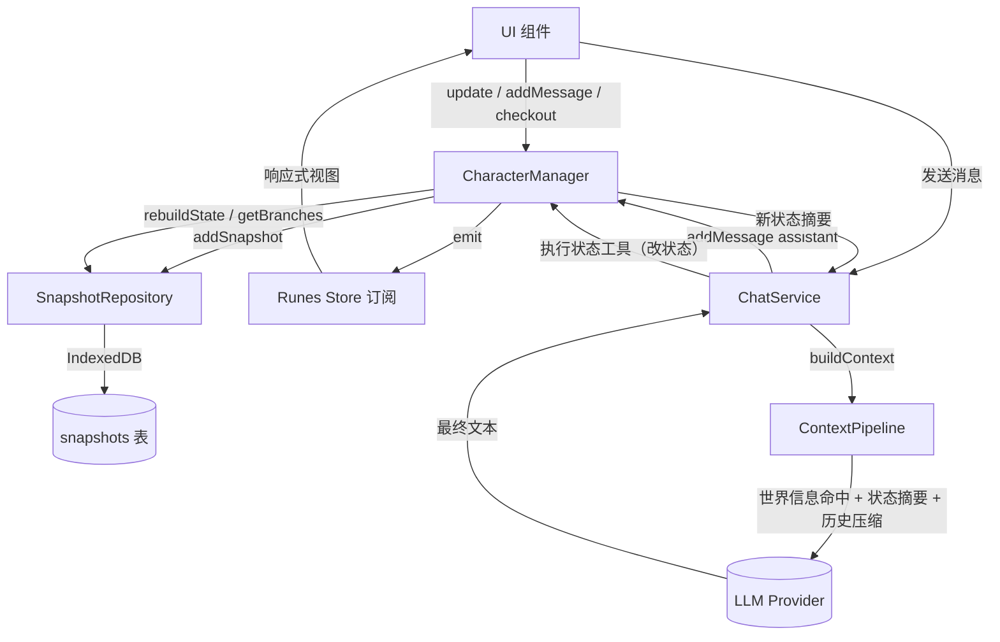
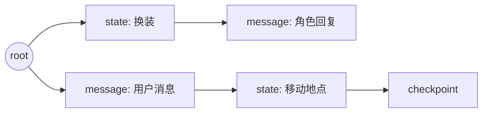
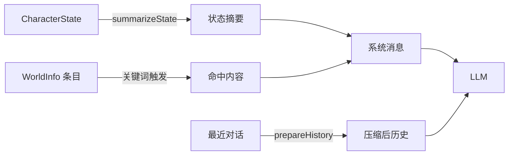
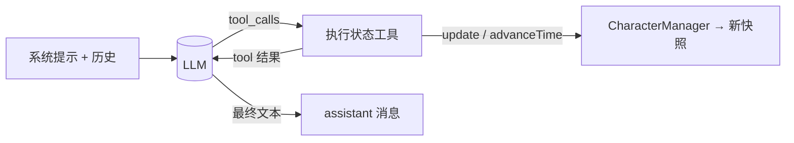

# CosBox 架构

## 设计原则

1. **状态驱动叙事**：`CharacterState`（outfit / location / places / schedule / attributes）是应用的第一公民数据。
2. **单一变更入口**：一切状态修改必须经过 `CharacterManager.update()`，先校验、再落快照、后生效。
3. **串行化变更**：所有变更（update / addMessage / checkout / advanceTime / addCheckpoint）经内部队列串行落地，
   避免并发写导致的分支错乱与状态覆盖。
4. **无副作用 checkout**：切换分支只做纯重建（读 IndexedDB + 应用 delta），绝不写快照表。
5. **浏览器内自带版本控制**：以「增量快照链」实现类 Git 语义，不依赖外部 Git 运行时。
6. **世界配置与剧情状态分离**：地点库 / 衣柜 / 日程条目是「世界配置」，维护性编辑
   单独持久化（kv），不生成快照、不进版本历史；剧情状态（当前地点、当前穿着、时间、
   属性、对话）仍走快照链。

## 数据流

## 快照版本图

- 节点结构：`{ id, timestamp, parentId, metadata: { type, desc }, delta }`。
- `delta` 三态：`{ kind: 'state', patch: StatePatch }`、`{ kind: 'message', ... }`、`null`（检查点）。
- **分支**：任何没有子节点的节点都是一个分支 tip；从该 tip 继续追加即开新分支。
- **重建**：沿 `parentId` 回溯到根，按时间顺序应用状态补丁、收集消息；根自身不参与 delta 应用（初始状态即根基线）。
- **checkout**：`rebuildState(targetId)` 的纯读别名，不产生任何写入。

存储：IndexedDB `snapshots` 表，索引 `id, [parentId+timestamp], parentId, timestamp`。

### 分支删除

- 只能删除「分支末端链」：从某个 tip 沿 parentId 回溯到分支点（不含分支点与根）的一整段链。
- 若当前 head 位于被删链上，先 `checkout` 到链的父节点（分支点或根），保证 head 永远有效。
- 根快照与任何非末端节点不可删除（防止孤儿链）；删除在 `CharacterManager` 的串行队列内执行。

### 世界配置覆盖

- 「地点库」「衣柜管理」「日程表」面板的维护性编辑（增删改条目）调用
  `CharacterManager.applyConfig()`：只更新内存态并写入 kv（`config.overrides`），
  不生成快照、不推进 head，因此不会出现在版本/分支中。
- 每次从快照链重建状态（init / checkout / 删除分支）后，把配置覆盖叠加回状态
  （`applyConfigOverrides`，整体替换 places / outfit.wardrobe / schedule.entries）。
- 剧情状态不受影响：在面板里「设为当前地点」「更换当前穿着」「推进时间」仍走 `update()`
  生成快照。

## 状态模型

- `outfit`：当前穿着（headwear / top / underwear / underpants / bottom / socks / shoes / accessories）
  - `wardrobe` 衣柜（衣物预设，带分类与穿后描述）。
- `location`：当前所在地（带分类）；`places`：地点库（AI 认知中的全部地点，带分类，如「学校 > 食堂」，
  与日程相互独立）。
- `schedule`：时间与周期性日程；`attributes`：自由键值属性。
- LLM 上下文中的状态摘要包含【已知地点】与【衣柜】清单（含分类前缀），AI 换装/移动时从清单中选择，而非自行脑补。

## 模块边界

| 模块             | 职责                                             | 依赖方向        |
| ---------------- | ------------------------------------------------ | --------------- |
| `core/`          | 类型、状态校验/合并、版本图纯函数、错误体系      | 无（纯函数）    |
| `db/`            | Dexie schema、快照/世界书/kv 仓储                | core            |
| `manager/`       | 状态变更编排（校验→快照→应用→刷新）              | core, db        |
| `context/`       | World Info 触发、状态摘要、历史压缩、Prompt 组装 | core, llm/types |
| `llm/`           | OpenAI-compatible 客户端、离线 demo、状态工具、agent 循环 | core, context   |
| `import-export/` | chara_card_v3 解析与序列化                       | core            |
| `stores/`        | Svelte 5 runes 响应式封装（薄层，不含业务逻辑）  | manager, db     |
| `utils/`         | 纯工具（格式化、分组、斜杠命令解析/执行）       | core            |
| `components/`    | 展示与表单（显式 props，无 rest 透传）           | stores, core    |

## Context Pipeline

输出 `ContextBundle`：`systemMessage`（基础提示 + 状态摘要 + 世界设定）与可直接提交给
Chat Completions API 的 `messages` 数组。

## Agent 工具循环

调研结论（OpenAI Agents SDK / Anthropic tool use / ReAct 一致）：工具以 JSON Schema 注册，
LLM 输出结构化 `tool_calls`，宿主执行并把 `tool` 结果放回对话，循环直到模型直接输出文本。

- 工具：`goto_location`（按 id/名称匹配地点库）、`advance_time`、`set_outfit`
  （必须从衣柜中选衣，防止脑补）、`set_attribute`。
- 每轮工具执行都会生成一个 `state` 快照；每轮结束重新生成状态摘要，让模型感知最新状态。
- 最大轮数（默认 4）防死循环；工具失败以错误文本回馈模型继续尝试，而不是中断。
- 设置项「允许 AI 自主修改状态」默认关闭；关闭时退化为纯文本对话。
- 工具调用与 `tool` 结果只是循环内的临时消息，绝不落成用户可见快照。

## RP 斜杠命令

输入框以 `/` 开头时不再发普通消息，而是直接操作状态（同样生成快照）：

- `/goto 地点`：按名称 / `分类>名称` / 唯一分类匹配地点库，切换当前地点。
- `/wear 槽位=衣物` 或 `/wear 衣物名`：从衣柜中选衣换装；`=无` 表示脱掉；
  自动按 `kind` 推断槽位并校验类型，禁止「内裤套头上」。
- `/time +30`：推进/回拨世界时间；`/checkpoint 描述`：保存检查点；`/help`：命令帮助。

命令执行后追加一条 `system` 提示（如「（命令）切换地点：学校 > 食堂」），
让 AI 感知这次转场/换装；命令解析与执行是 `utils/slash.ts` 的纯函数，落地仍走 CharacterManager。

## 开发者模式

- 设置 →「开发者功能」开启后，对话页显示一个可展开的「最近一次发送给 AI 的完整提示词」
  区块（系统消息 + 实际发送的消息数组，含工具调用）。
- `ChatService.generateReply` 额外返回 `debug` 视图，由页面在每次发送后更新。

## 错误处理约定

- 所有异步操作带 `try/catch`，统一翻译为 `CosBoxError` 子类。
- UI 通过 `toUserMessage()` 展示可读文案，不泄露堆栈。
- 测试覆盖每个仓储的失败路径（关闭数据库触发）。

## 测试策略

- 核心层（`core/context/db/manager/llm/import-export/utils`）：Vitest，语句/行/函数覆盖 100%，分支 ≥90%。
- UI 流程：Playwright e2e（对话、状态编辑、版本切换/删除、时间推进、V3 导入、斜杠命令、
  AI 状态工具、配置编辑不生成快照、设置与开发者模式）。
